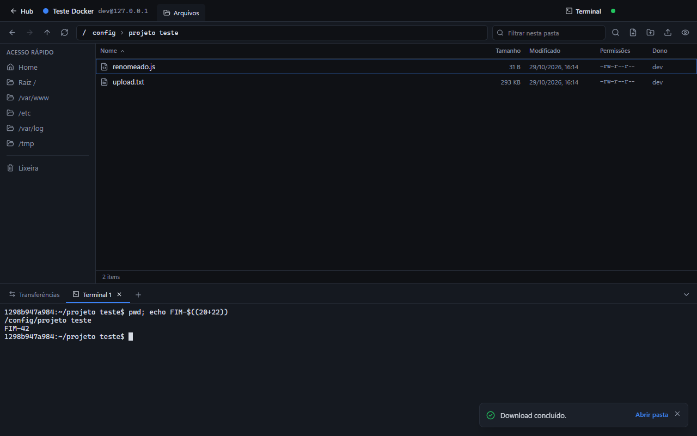
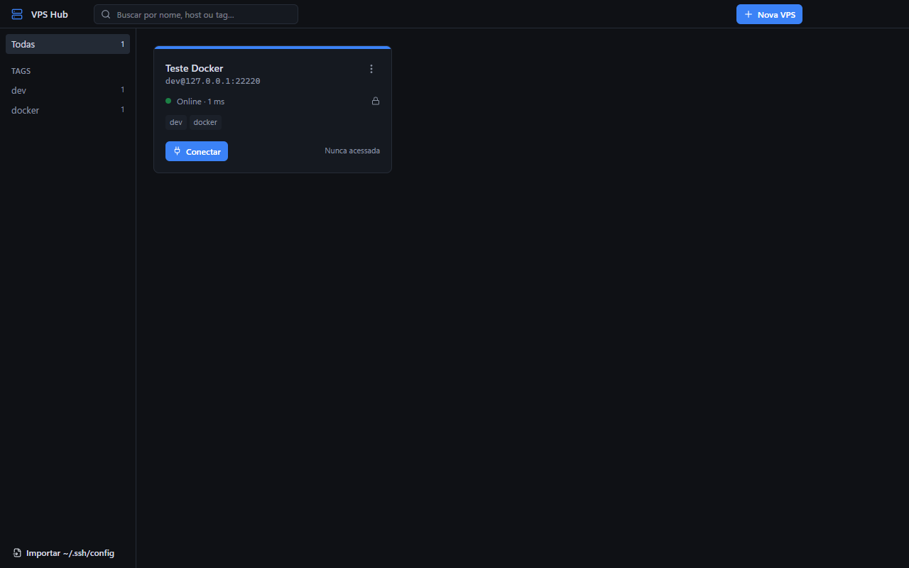
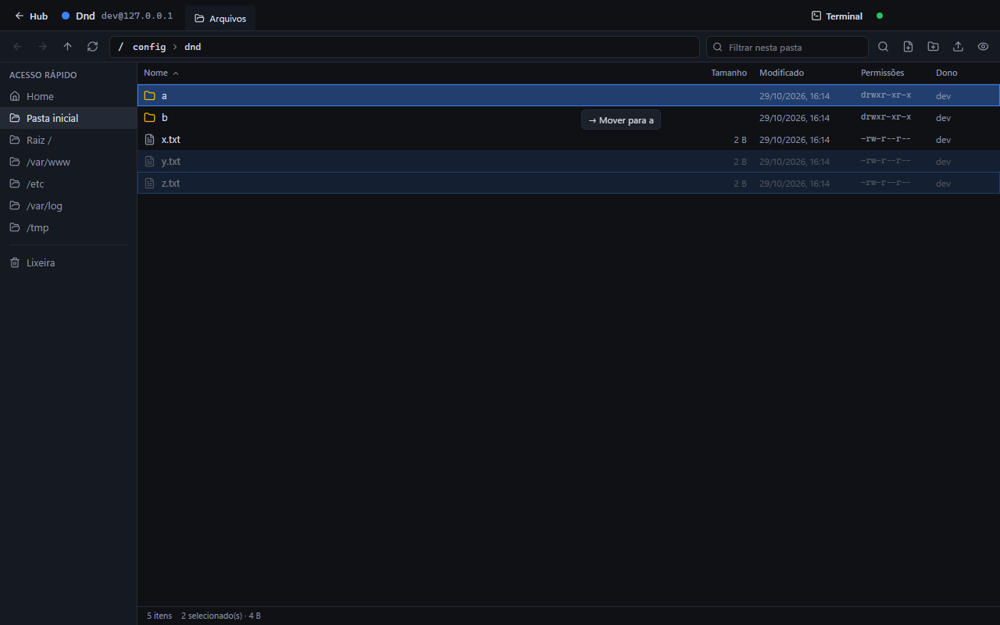
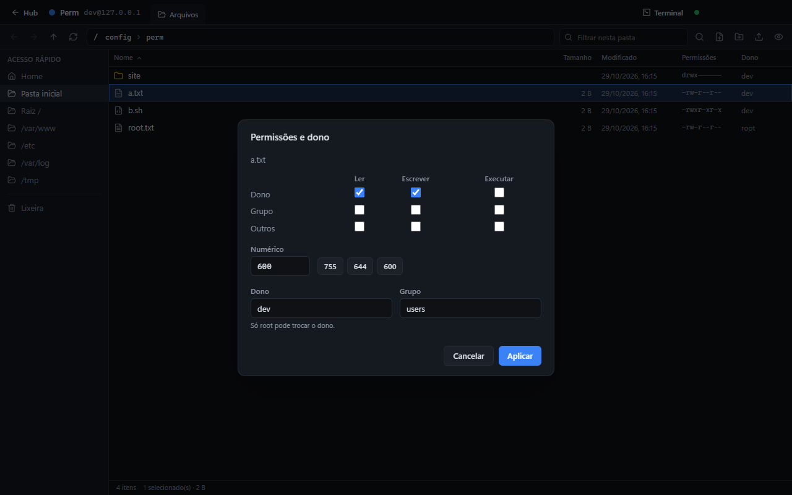

# VPS Hub

App desktop para Windows que reúne suas VPS num só lugar e deixa você **navegar, editar e organizar os arquivos delas como no Explorer do Windows**, via SSH/SFTP, sem precisar decorar comandos no terminal.



## Destaques

- **Hub de conexões**: cadastre várias VPS (senha ou chave SSH), teste antes de salvar, veja quem está online e importe os hosts do seu `~/.ssh/config`.
- **Explorador como o do Windows**: seleção por retângulo, Ctrl/Shift, atalhos de teclado, **arrastar e soltar** para mover/copiar e **Desfazer**.
- **Editor** (o mesmo do VS Code) e **terminal** integrados, abertos na pasta atual.
- **Lixeira na própria VPS**: excluir é reversível.
- **Busca** por nome e por conteúdo, **permissões e dono** com caixas de seleção, **compactar/extrair** zip e tar.
- **Copiar e colar entre VPS diferentes.**

| Hub | Arrastar e soltar | Permissões |
|---|---|---|
|  |  |  |

## Funcionalidades

### Conexões
- **Hub**: cadastrar, editar, duplicar e excluir conexões; testar a conexão antes de salvar; status online e latência; tags e busca.
- **Autenticação** por senha ou chave privada (OpenSSH ou `.ppk`, com passphrase). Senhas e passphrases podem ser lembradas, criptografadas pelo Windows (DPAPI); se não estiverem salvas, o app pede ao conectar. Se o servidor não aceitar o método escolhido (ex.: só chave), o app explica.
- **Importar `~/.ssh/config`**: lê os hosts com as regras do OpenSSH (`Host *`, `IdentityFile`, `Port`, `User`), marca os já cadastrados e avisa sobre `ProxyJump`, ainda não suportado.
- **Host key**: na primeira conexão o fingerprint é exibido para confirmação; se mudar depois, o app avisa (possível ataque man-in-the-middle).
- **Queda de conexão**: as abas continuam abertas e um botão reconecta, sem perder edições.

### Explorador
- Navegação com histórico, caminho clicável e editável (Ctrl+L, aceita `~`), Acesso rápido, ordenação, filtro e arquivos ocultos.
- **Seleção como no Windows**: clique, Ctrl/Shift+clique, **retângulo de seleção** a partir do espaço em branco (Ctrl inverte, Shift soma, rola sozinho), Home/End/PageUp/PageDown (com Shift), Ctrl+setas e Ctrl+Espaço, e digitar o começo do nome para pular até o item.
- **Arrastar e soltar**: arraste pelo ícone/nome para uma pasta, um trecho do caminho ou o Acesso rápido para **mover** (Ctrl copia), ou para a Lixeira. Sem confirmação, com **Desfazer** na notificação. Um balão mostra a ação e o destino; parar sobre uma pasta a abre, e parar sobre Voltar/Pasta acima sai dela. Cancelar (Esc) volta à pasta de origem.
- **Arquivos do Windows**: arraste arquivos e pastas do seu PC para enviar, direto para a pasta onde soltar.
- **Copiar, recortar e colar** (Ctrl+C/X/V): na mesma VPS o servidor faz o trabalho (`cp -a`/`mv`); entre VPS diferentes a cópia passa pelo app, preservando permissões e links. Colar na mesma pasta cria "nome - cópia".
- **Busca** (Ctrl+F): por nome ou por conteúdo, na pasta e subpastas. Resultados de conteúdo mostram a linha e abrem o editor nela. Cancelável, até 500 resultados.
- **Permissões e dono** (Alt+Enter): caixas ler/escrever/executar, valor numérico (755, 644, 600), troca de dono e grupo, aplicação recursiva só em pastas ou só em arquivos. Em seleção múltipla, bits diferentes aparecem como "misto" e só mudam se clicados.
- **Compactar e extrair**: cria `.zip`/`.tar.gz`; extrai `.zip`, `.tar`, `.tar.gz`/`.tgz`, `.tar.bz2` e `.tar.xz` numa pasta nova ou na própria pasta. Se faltar o `zip` na VPS, o app mostra o comando de instalação e pode instalar para você (com root ou sudo sem senha).
- **Lixeira** em `~/.vpshub-trash` na VPS: Del manda para a lixeira (com Desfazer); dá para restaurar ao local original ou esvaziar. Shift+Del apaga de vez.

### Editor, terminal e transferências
- **Visualizador de imagens** (png, jpg, gif, webp, bmp, ico, avif, svg até 25 MB): abre ao dar duplo clique, com zoom (roda do mouse, 100%, ajustar), arrastar para mover, fundo xadrez e dimensões. SVG é exibido só como imagem (scripts não rodam) e "Ver código" abre no editor.
- **Editor Monaco** com abas e Ctrl+S. Arquivos Markdown (`.md`) abrem com **pré-visualização ao lado** (GFM: tabelas, listas de tarefas, código), atualizada enquanto você digita; o HTML é sanitizado e links não navegam. Detecta se o arquivo mudou no servidor antes de salvar, grava de forma atômica (temporário + rename) e recusa binários, arquivos não UTF-8 e acima de 5 MB.
- **Terminal** (xterm.js) aberto na pasta atual, com várias abas.
- **Upload e download** com progresso, inclusive de pastas. Cada transferência pode ser **cancelada** (o arquivo parcial é apagado) e **repetida** se falhar ou for cancelada.

### Proteções
- Pastas do sistema (`/`, `/etc`, `/usr`…) e a home não podem ser excluídas, movidas nem alteradas recursivamente.
- Arquivos compactados com entradas que escreveriam fora da pasta (`../`, caminhos absolutos — "zip slip") são recusados.
- Substituir algo (colar, extrair, soltar) manda a versão anterior para a lixeira.
- Aviso ao fechar o app com arquivos não salvos.

## Instalação

Requer **Windows 10 ou 11**. Gere o instalador a partir do código:

```bash
npm install
npm run dist
```

O instalador fica em `dist/VPS Hub Setup <versão>.exe`. Ele não é assinado digitalmente, então o Windows SmartScreen pode avisar na primeira execução: clique em **Mais informações → Executar assim mesmo**.

## Desenvolvimento

Requer **Node.js 22+** (desenvolvido com Node 24).

```bash
npm install
npm run dev        # abre o app em modo desenvolvimento (F12 abre o DevTools)
npm run typecheck  # checagem de tipos
npm run build      # build de produção em out/
npm run dist       # instalador Windows em dist/
npm run test:e2e   # testes de ponta a ponta (precisa do Docker Desktop rodando)
```

### Testes

`npm run test:e2e` gera o build, sobe dois servidores SSH descartáveis em Docker (portas 22220 e 22221), abre o app de verdade com Playwright e roda **89 cenários**: conexão e host key, explorador, editor, transferências (cancelar e repetir), terminal, queda de conexão, chave com passphrase, importação do `~/.ssh/config`, lixeira, compactar/extrair, copiar/colar entre VPS, seleção, arrastar e soltar (inclusive arquivos do Windows), permissões e busca (com BusyBox e GNU grep). Os containers são removidos ao final; use `VPSHUB_E2E_KEEP=1` para mantê-los.

Para rodar só uma suíte (depois de `npm run build`):

```bash
node --test --test-global-setup=tests/e2e/setup.mjs tests/e2e/paste.test.mjs
```

## Arquitetura

Electron + React + TypeScript, com `ssh2` para SSH/SFTP.

```
src/
├─ main/        processo principal (Node): SSH, SFTP, terminal, armazenamento
│  ├─ store.ts      conexões, segredos criptografados e host keys (userData/vps-hub.json)
│  ├─ sessions.ts   uma conexão SSH por VPS, verificação de host key
│  ├─ files.ts      operações SFTP e transferências
│  ├─ trash.ts      exclusão, lixeira e restauração
│  ├─ paste.ts      copiar/recortar/colar (mesma VPS e entre VPS)
│  ├─ archive.ts    compactar e extrair (zip/tar)
│  ├─ perms.ts      permissões e dono (chmod/chown/chgrp)
│  ├─ search.ts     busca por nome (find) e conteúdo (grep)
│  ├─ sshConfig.ts  leitura do ~/.ssh/config
│  ├─ terminals.ts  shells interativos
│  └─ ipc.ts        canais IPC
├─ preload/     ponte segura (contextIsolation) que expõe window.vpsApi
├─ renderer/    React: Hub e Workspace (explorador, editor, terminal, transferências)
└─ shared/      tipos e utilitários de caminho usados pelos dois lados
tests/e2e/      testes de ponta a ponta (node --test + Playwright + Docker)
```

**Segurança**: só o processo principal lida com credenciais, rede e disco; a interface nunca recebe senhas nem chaves. A janela roda com `contextIsolation`, `sandbox` e sem integração com Node. Todo comando enviado à VPS tem os caminhos escapados.

Detalhes de arquitetura e convenções para quem for mexer no código estão em [CLAUDE.md](CLAUDE.md).

## Contribuindo

Mensagens de commit em inglês, no padrão [Conventional Commits](https://www.conventionalcommits.org/) (`feat:`, `fix:`, `docs:`, `test:`…). Antes de abrir um PR, rode `npm run typecheck` e `npm run test:e2e`, e adicione cenários de teste para funcionalidades novas.

## Licença

[MIT](LICENSE)
